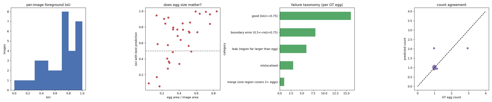
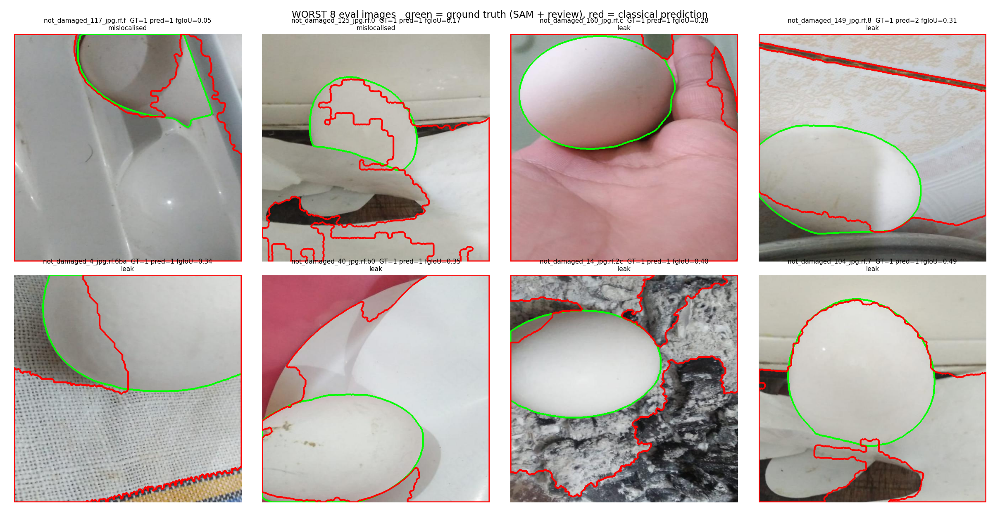
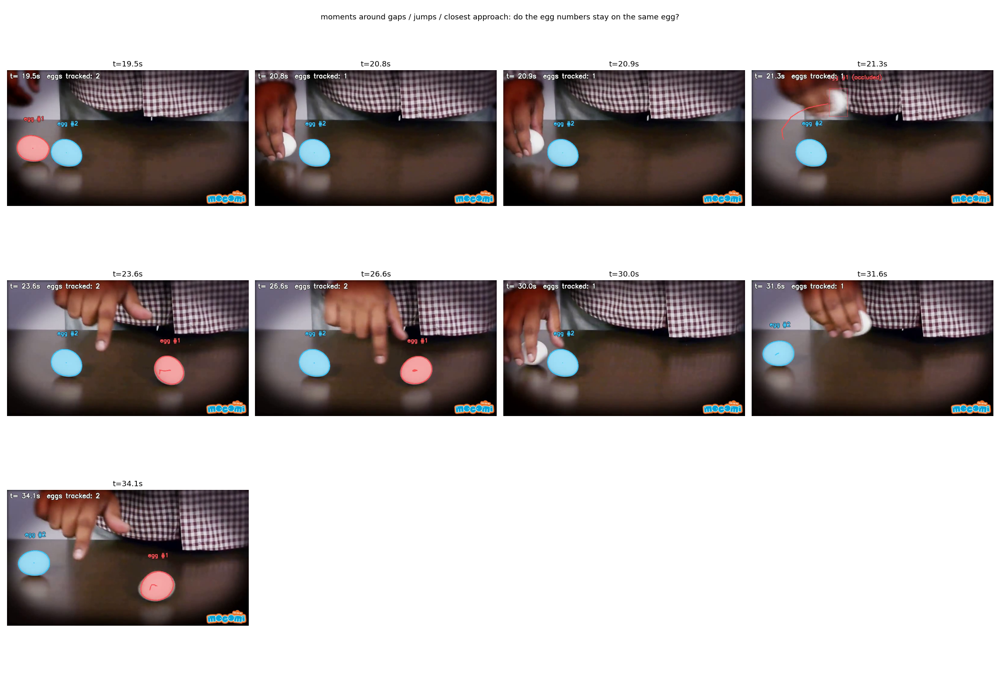

# Egg Segmentation and Tracking

**Nosh Robotics CV Intern Task** · Author: **K Pradeep Kumar**

Find every egg in a set of photos, build a classical (non-deep-learning) segmenter that matches a SAM-based reference, evaluate it honestly on held-out images, then track individual eggs in a YouTube video.

| | |
|---|---|
| **Report (PDF)** | [`report/Egg_CV_Report.pdf`](report/Egg_CV_Report.pdf) |
| **Tracking video (public)** | [Google Drive](https://drive.google.com/file/d/10tqBCNuAKUDZLcVYgcEYjmvncy57eFi1/view?usp=sharing) |
| **Dataset** | Roboflow `egg-vzhtr`, version 2, 160 images of 640 x 640 |
| **Source video** | https://www.youtube.com/watch?v=Y4JyV94y2_A |

---

## Results at a glance

| Task | What was built | Headline result |
|---|---|---|
| **1** | OWLv2 text-prompted boxes into SAM ViT-H masks, plus a documented human review | 182 eggs in 160 images; 120 images accepted automatically, 29 edited by hand |
| **2** | Leak-free 4:1 split (128 dev / 32 eval) and a classical segmenter, with a six-trial experiment log | Dev F1@0.5 = **0.717** (5-fold, out-of-fold) |
| **3** | One-shot evaluation on the 32 held-out images against the Task 1 masks | F1@0.5 = **0.706** (95% CI 0.545-0.849), fg IoU 0.674, Dice 0.772, count MAE 0.062 |
| **4** | Video segmenter and tracker with stable egg IDs | 2 eggs tracked 9.4-41.8 s; coverage 81.4% and 92.0%; an ID swap found and fixed |



---

## How it works

### Task 1: reference masks from pretrained models
SAM has no idea what an egg is, so it is prompted by a detector.
1. **OWLv2** is queried with three phrases ("a photo of an egg", "a white egg", "a partially visible egg cut off at the edge of the image").
2. Boxes are filtered (score >= max(0.10, 0.4 x best in image)) and merged with NMS.
3. Each box prompts **SAM ViT-H**; masks get holes filled and the largest component kept.
4. A looser fallback runs if nothing is found. A human then reviewed the results (see the disclosure below).

### Task 2: leak-free split and classical segmenter
- **Split:** images are grouped by perceptual hash (Hamming distance <= 8) and by Roboflow parent filename, then split by group with `GroupShuffleSplit(test_size=0.2, random_state=43)`. The code asserts that no group is on both sides. The eval split is touched once, in Task 3.
- **Method (final trial T5), propose and rank:**
  1. Threshold five colour channels (L, a, b, saturation, whiteness) with Otsu in *both polarities*, then clean with morphology to get candidate regions.
  2. Describe each candidate with 25 shape, edge, contrast and colour features.
  3. A Random Forest predicts each candidate's IoU with the true egg.
  4. The top six candidates are refined with GrabCut and re-ranked by a second Random Forest.
- **Experiment log:** [`results/task2/experiment_log.md`](results/task2/experiment_log.md) lists all six trials, T0-T5. It records what changed, why, the parameters, the dev results and the keep/discard decision, failures included.

| Trial | Idea | Dev F1@0.5 | Decision |
|---|---|---|---|
| T0 | Grey + global Otsu | 0.363 | discard (assumes a bright egg) |
| T1 | LAB whiteness cue | 0.405 | discard (same polarity assumption) |
| T2 | Both polarities, 5 channels, hand-set score | 0.489 | discard (weights pick corners) |
| T3 | Learned linear ranker (Ridge) | 0.681 | discard (cannot model interactions) |
| T4 | Random Forest ranker | 0.715 | superseded |
| **T5** | **+ GrabCut-refined candidates** | **0.717** | **keep (final)** |

### Task 3: evaluation
Predicted instances are matched to reference eggs by the Hungarian algorithm. Reported: precision / recall / F1 at IoU 0.5 and 0.75, matched IoU, foreground IoU and Dice, count error, bootstrap confidence intervals, and a failure taxonomy (good 16, boundary 8, leak 6, mislocalised 3, merge 1, plus 4 false-positive regions). Best and worst cases are in [`results/task3/`](results/task3/).



### Task 4: tracking eggs in the video
- **Segmenter:** whiteness in LAB, morphology, watershed to split touching eggs, shape filters. It matches SAM on 50 sampled instances with mean IoU 0.949.
- **Tracker:** Hungarian association on motion-shifted mask IoU, distance and area. Tracks are confirmed after five hits, coast through occlusion for up to 8 s, and ghost tracks are filtered. A second pass renders only the real tracks.
- **Found by auditing, then fixed:** the first tracker swapped the two egg IDs at about 31 s. Version 2 adds *guided re-detection* ("in hand"), so a track follows its egg while it is held. v2 is the submitted video.

| | Egg #1 | Egg #2 |
|---|---|---|
| Detection coverage v1 to v2 | 69.5% to 81.4% | 97.4% to 92.0% |
| Longest gap without detection (v2) | 4.12 s (fully hidden) | 2.08 s |



---

## Setup

Python 3.10+. Tasks 2, 3 and 4 run on CPU. Task 1 needs a GPU (a Colab T4 is enough) and downloads about 2.6 GB of SAM weights.

```bash
git clone https://github.com/KpradeepKumar25/Egg-segmentation-and-tracking.git
cd Egg-segmentation-and-tracking
pip install -r requirements.txt
sudo apt-get install ffmpeg          # Task 4 H.264 output (preinstalled on Colab)
export ROBOFLOW_API_KEY=...          # never commit this; on Colab use Secrets
```

The notebook [`notebooks/run_all_colab.ipynb`](notebooks/run_all_colab.ipynb) runs everything below, cell by cell, on Colab.

## Run

```bash
python scripts/01_make_split.py        --work work   # download + leak-free split
python scripts/02_task1_sam_labels.py  --work work   # Task 1 (GPU)
python scripts/03_train_classical.py   --work work   # Task 2: trains on dev only
python scripts/04_eval_task3.py        --work work   # Task 3: one-shot eval
yt-dlp -f "b[height<=720][ext=mp4]" -o work/source.mp4 https://www.youtube.com/watch?v=Y4JyV94y2_A
python scripts/run_task4_video.py --video work/source.mp4 --out work/task4   # Task 4 (--no-guided = v1)
```

Frozen outputs of the submitted run are already in [`results/`](results/), so you can inspect every number without re-running.

## Repository layout

```
src/eggcv/   data.py  task1_sam.py  classical.py  metrics.py  video.py
scripts/     01_make_split.py  02_task1_sam_labels.py  03_train_classical.py
             04_eval_task3.py  run_task4_video.py
results/     split/  task1/  task2/  task3/  task4/
report/      Egg_CV_Report.pdf
notebooks/   run_all_colab.ipynb
docs/        build_report.py
```

## Honest notes and limitations

- **Reference masks are not independent ground truth.** They are SAM output corrected by a person, so Task 3 measures agreement with them, not absolute accuracy. The human edits (picking, deleting, adding eggs) are recorded in the `REVIEW_*` tables in `src/eggcv/task1_sam.py`. They reproduce the submitted labels only if the automatic stage gives the same output as the original run; GPU non-determinism can shift this. `--no-review` keeps the purely automatic labels.
- **Dataset version:** the task PDF links `dataset/1`; version 2 (160 images) is what was downloaded and used throughout.
- **Small evaluation set:** 32 images and 34 eggs, so confidence intervals are wide (about +/- 0.15 on F1).
- **Main failure mode:** the classical method leaks into pale surroundings (6 of 34 eggs) because a colour or edge cue has no notion of egg shape.
- **Video:** there are no ground-truth identity labels, so identity was checked by an audit and by inspecting frames. "No swaps found" is not proof. Egg #1 is undetected for up to 4.1 s while fully hidden by the hand. The segmenter is tuned to this scene, and one parameter (`ellipse_iou_min`) is fragile when loosened.
- **Split:** one random draw (seed 43); a different seed would give different eval images.

## Conclusion

This project went from raw photos to tracked eggs in a video in four steps, and every number above comes from a split that was fixed before the held-out images were touched.

- **Task 1:** prompting SAM with OWLv2 text detections gave usable masks for all 160 images (182 eggs). About 18% of the images needed a manual fix, and each fix is recorded in the repo.
- **Task 2:** a classical propose-and-rank segmenter reached F1@0.5 = 0.717 on dev. Learning the ranking, not the thresholding, was the biggest gain (0.49 to 0.68). GrabCut refinement then improved boundary quality (matched IoU 0.80 to 0.81) but did not improve detection.
- **Task 3:** on the 32 held-out images it scored F1@0.5 = 0.706 (95% CI 0.545-0.849) with the egg count correct in 93.8% of images. The main weakness is leaking into pale surroundings, so it is good at finding eggs and weaker at outlining them tightly (F1@0.75 = 0.471).
- **Task 4:** two eggs are tracked through occlusion and hand movement with stable IDs. The audit exposed an ID swap in the first tracker, and guided "in hand" re-detection in v2 fixed it.

**What I would do next:** add a small learned model for the boundary, since colour and edge cues cannot tell a pale egg from a pale wall. I would also hand-label identities in a few video segments to measure ID switches numerically, and test on more videos than this one scene.

## AI tool disclosure

Claude (Anthropic) was used as a coding and analysis assistant: drafting and debugging code, suggesting experiments, and writing documentation. The author ran the experiments, reviewed the Task 1 masks by hand, made the keep/discard decisions, and is responsible for the results.
